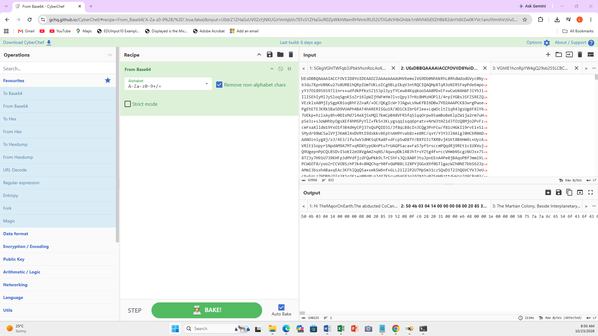
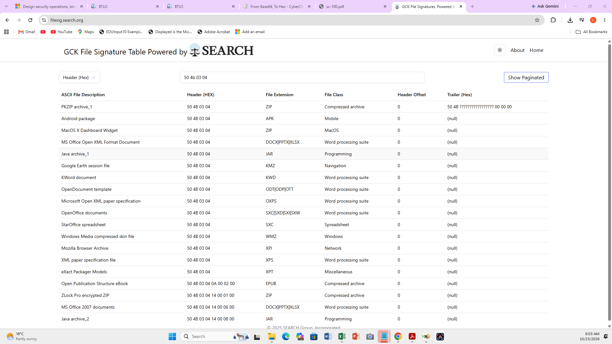
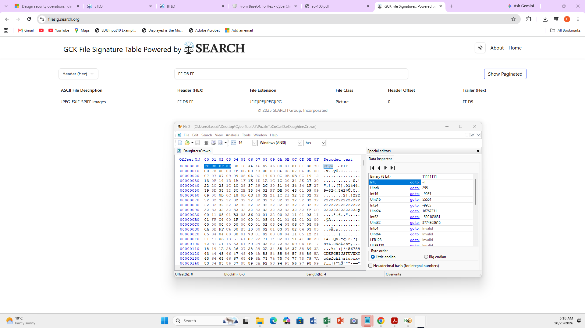
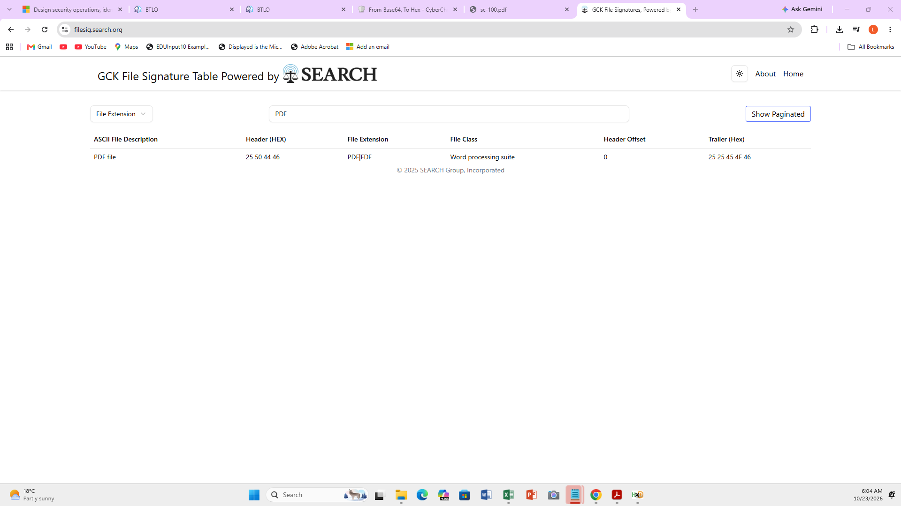
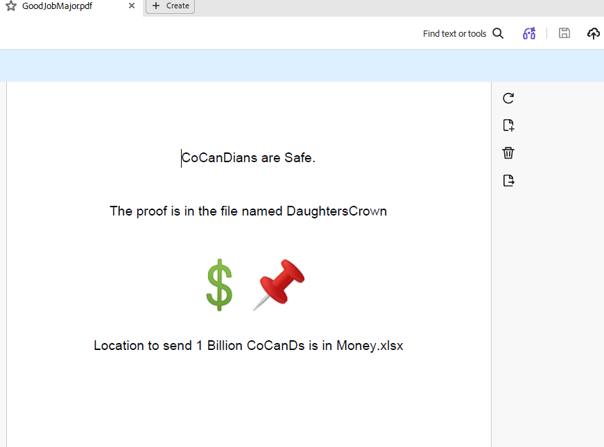
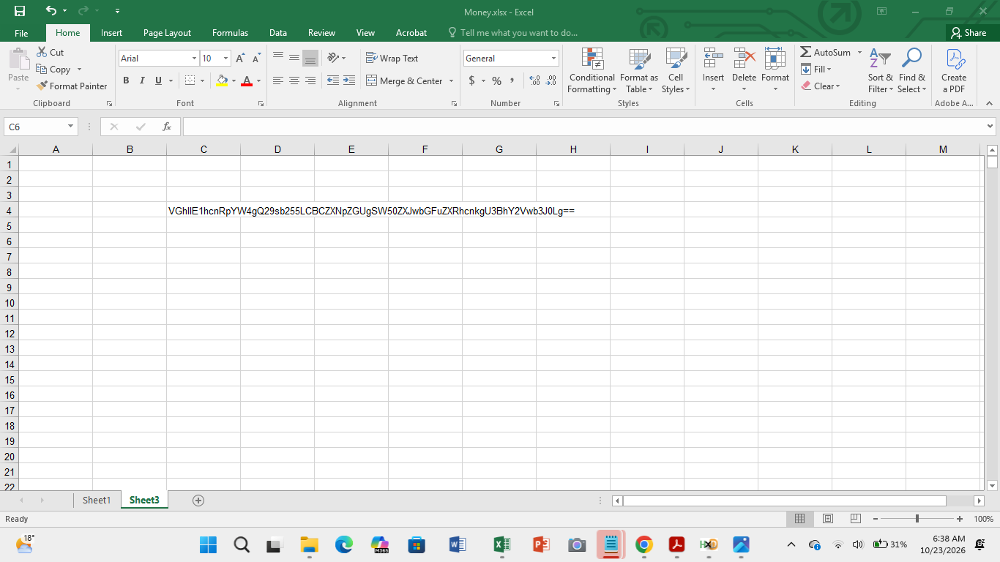
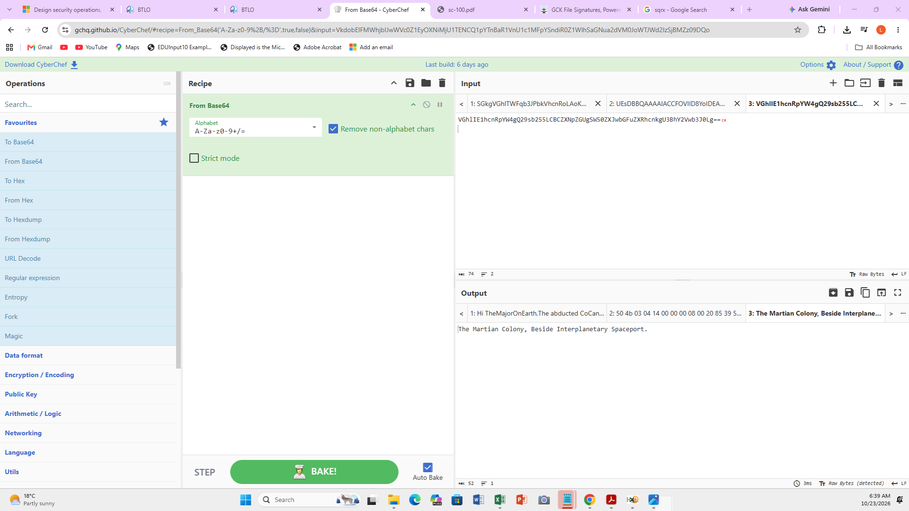
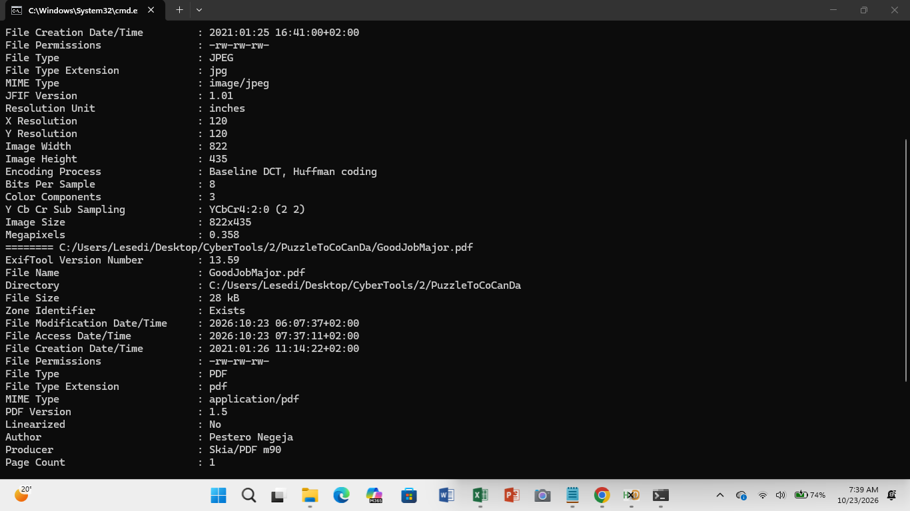

# 🕵️‍♀️ The Planet's Prestige — Email Phishing Investigation

## 🌍 Lab Scenario

CoCanDa, a planet known as "The Heaven of the Universe," has been experiencing a difficult period. A series of riots has broken out due to the frequent abduction of its citizens, known as CoCanDians, by a mysterious force.
CoCanDa's Planetary President organised a war room with leading experts and military officials to find a solution. Shortly after the meeting, the President was informed that his daughter had disappeared.
Agents were deployed across multiple planets to investigate the disappearances. However, after two days, there were no updates, ransom demands, or clues regarding the whereabouts of the missing citizens.
On the third day, a CoCanDa representative, an Army Major stationed on Earth, received an email.

My task was to investigate the email, analyse its contents, examine the attached files, and uncover information that could help move the investigation forward.

## 📧 1. Initial Email Examination
To begin the investigation, I downloaded the file containing the email details and its encoded message.

I examined the available email information, including the Delivered To, Received From, subject line, and other email header details. This helped me investigate the email's origin and understand how it had been delivered.

## 🔓 2. Decoding the First Email Message Using CyberChef

While examining the email, I noticed the following header:
Content-Transfer-Encoding: base64
This indicated that the relevant email content was encoded in Base64 format. To make the message readable, I used CyberChef and selected the From Base64 operation to decode the first part of the email.

After decoding the message, I discovered that the sender explicitly mentioned an attachment that would provide further information for the investigation.
This clue led me to investigate the second encoded message.

## 🧩 3. Investigating the Second Message and Identifying the File Type

I returned to CyberChef to decode the second message. However, the From Base64 operation did not produce the expected result.
I then tried a different approach by converting the data to hexadecimal using the To Hex operation. This allowed me to examine the underlying bytes of the data.

The hexadecimal representation provided an important clue. A file's signature, also known as its magic number or file header, can help identify its actual format.
Although the email indicated that the file was a PDF, I did not assume that the stated format was correct. File extensions and descriptions can be misleading, so I needed to verify the file type independently.
I copied the relevant hexadecimal signature and consulted Gary Kessler's File Signature Table to identify the corresponding file format.
The investigation revealed that the file was actually a ZIP archive, rather than a standalone PDF file.
After identifying the ZIP archive, I proceeded to examine its contents to discover what additional information it contained.

## 🗂️ 4. Examining the Files Inside the ZIP Archive
After extracting the ZIP archive, I discovered three files that required further investigation.
To identify the actual formats of these files, I downloaded and used HxD, a hexadecimal editor that allows me to inspect a file's underlying hexadecimal data.
I examined the file signatures and compared them with the entries in Gary Kessler's File Signature Table. This helped me identify the file types based on their signatures rather than relying solely on their extensions.

### 🖼️ File 1: JPEG Image
The first file was identified as a JPEG image. After examining the file, I discovered that the image depicted a crown.

### 📄 File 2: PDF Document
To investigate the second file, I referred to the PDF file signature listed in Gary Kessler's File Signature Table and compared it with the hexadecimal data obtained using HxD.
The analysis confirmed that the second file was a PDF document. After opening it, I discovered further instructions explaining how to continue the investigation into the missing daughter.
The instructions directed me to examine the Excel workbook included in the archive.

## 📊 5. Investigating the Excel Workbook
I opened the Excel workbook and discovered that it contained two worksheets. The second worksheet initially appeared blank, making it difficult to determine whether it contained any useful information.
I investigated the worksheet further and used Excel's Clear Formats feature to remove the existing cell formatting. This revealed content that had not been clearly visible before.
The revealed content was a Base64-encoded string.

## 🔍 6. Decoding the Excel Message
After discovering the Base64-encoded string in the Excel workbook, I returned to CyberChef to decode it using the From Base64 operation.

Decoding the string allowed me to reveal the hidden message and obtain further information relevant to the investigation.
This step demonstrated the importance of examining documents carefully, particularly when their contents may be concealed through formatting or encoded text.

## 🧾 7. Extracting File Metadata Using ExifTool
As an additional step in my investigation, I decided to examine the metadata associated with the files to look for clues about their possible author.
I downloaded and used ExifTool, a tool that extracts and displays metadata from various file formats.
By examining the file metadata, I found a name associated with the file that could provide a potential clue about the person responsible for creating it

This was an additional investigative step beyond simply decoding the messages and identifying the file formats. However, a name found in metadata should be treated as a potential lead rather than definitive proof of an attacker's identity

## 🎓 What I Learned

Completing this lab helped me develop a better understanding of how to investigate suspicious emails and examine files that may contain hidden information.

Key lessons from this investigation include:

Email analysis: How to examine email headers and review available delivery and sender information when investigating a suspicious email.
Base64 decoding: How to recognise Base64-encoded content and decode it using CyberChef.
File signature analysis: Why it is important to verify a file's actual format rather than trusting its extension or the description provided in an email.
Hexadecimal analysis: How to inspect a file's underlying bytes and use hexadecimal signatures to help identify file formats.
Archive investigation: How to examine an extracted ZIP archive and investigate its individual files.
Document investigation: How to follow investigative clues across PDF documents, Excel worksheets, and image files.
Hidden content discovery: How spreadsheet formatting can obscure visible content and why documents should be examined carefully.
Metadata analysis: How to extract file metadata using ExifTool and identify potential investigative leads.
Evidence-based investigation: Why findings should be supported by evidence and why metadata alone cannot conclusively establish attribution.
Analytical thinking: How to adapt my approach when an initial decoding method does not work as expected and follow clues across multiple files.

🛠️ Tools Used

Tool                                    Purpose

CyberChef                               Decoding Base64-encoded messages and converting data into hexadecimal representation.
HxD                                     Inspecting hexadecimal data and examining file signatures.
Gary Kessler's File Signature Table     Comparing file signatures to identify file formats.
Microsoft Excel                         Examining worksheets and revealing content obscured by cell formatting.
ExifTool                                Extracting and examining file metadata.

## 💻 Skills Gained

Through this hands-on lab, I practised the following skills:
Email phishing investigation and initial email triage.
Email header examination.
Base64 decoding and data transformation.
Hexadecimal data inspection.
File signature identification and file type verification.
ZIP archive and extracted-file investigation.
PDF, JPEG, and Excel document examination.
Discovery of visually obscured spreadsheet content.
File metadata extraction and preliminary attribution analysis.
Use of multiple investigative tools to follow evidence across different file types.
Technical documentation and investigative reporting.

## ✅ Conclusion

The Planet's Prestige lab gave me practical experience investigating a suspicious email and following a series of clues through encoded messages, file signatures, extracted documents, spreadsheet content, and file metadata.
It reinforced the importance of not making assumptions based on file extensions, adapting investigative techniques when an initial approach does not work, and using multiple tools to uncover information.

Lab platform: Blue Team Labs Online (BTLO)
Lab name: The Planet's Prestige
Investigation focus: Email phishing analysis and file investigation
