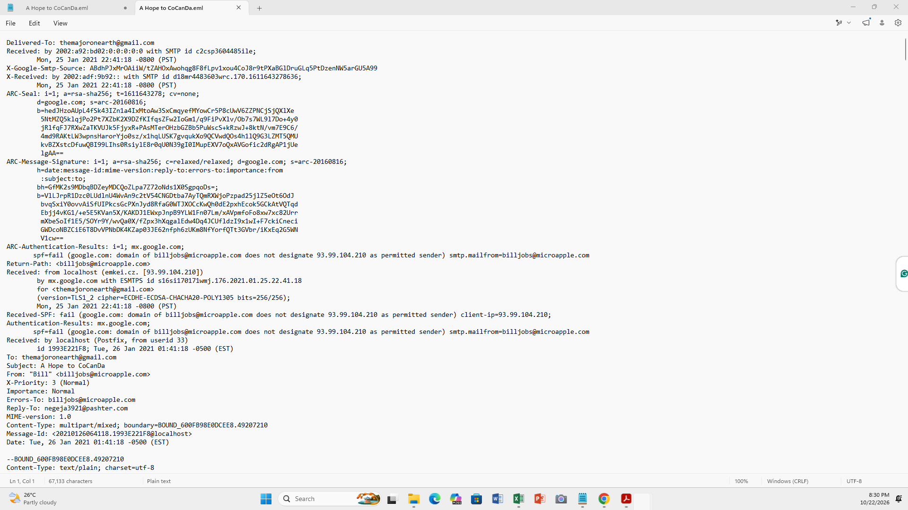
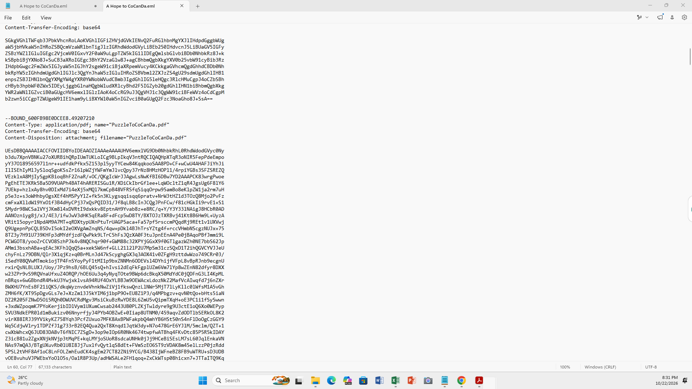
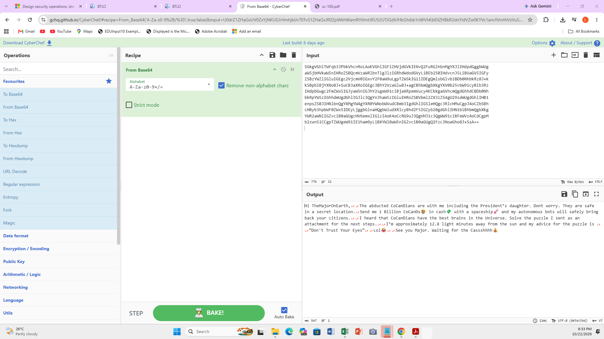

I have Completed a lab on Blue Teams Labs Online, on Email Phishing, the Lab is called The Planet's Prestige. 
This is the Scenario 
"CoCanDa, a planet known as 'The Heaven of the Universe' has been having a bad year. A series of riots have taken place across the planet due to the frequent abduction of citizens, known as CoCanDians, by a mysterious force. CoCanDa’s Planetary President arranged a war-room with the best brains and military leaders to work on a solution. After the meeting concluded the President was informed his daughter had disappeared. CoCanDa agents spread across multiple planets were working day and night to locate her. Two days later and there’s no update on the situation, no demand for ransom, not even a single clue regarding the whereabouts of the missing people. On the third day a CoCanDa representative, an Army Major on Earth, received an email."

For the Beginning of the investigation, I downloaded the file that contained the email details of the email with its encrypted message. 

Investigated where the email came from by looking at the Delivered To, Received From, The subject and every other detail that shows on the email.

To Continue using the Investigation, as it says on the email that the contents of the email "Content-Transfer-Encoding: base64" , the base64 tells me that message is in base64 format, so i used a website called CyberChef to paste and decode the first part of the email and used "From base64" to decode it.

The person that sent the email cleraly staes in the decoded message that he has sent an attachment for us to continue investing. so i went and decoded the second message, also in the same site, the CyberChef website and things were a little bit different there, the "base64 decoder didntwork, so i tried the other decodrs, tried the "To Hex" and it gave me the bits. 

![SecondMessage decoded](
